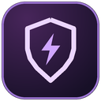
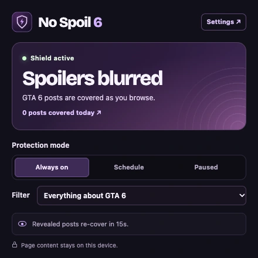

<p align="center">
  
</p>

<h1 align="center">No Spoil 6</h1>

<p align="center"><strong>Keep GTA 6 a surprise.</strong></p>
<p align="center">A browser extension that covers spoiler posts, attachments, and video cards as you scroll.</p>
<p align="center">
  <a href="https://hakashikatake.github.io/no-spoil-6/">Website &amp; demo</a> ·
  <a href="#install">Download</a> ·
  <a href="#using-the-shield">User guide</a> ·
  <a href="https://hakashikatake.github.io/no-spoil-6/support/">Support</a>
</p>


https://github.com/user-attachments/assets/f427ff7f-d279-47a9-bb77-e5e232eaf13b


> [!NOTE]
> **Chrome Web Store listing coming soon.** The browser builds are available now through the [manual installation steps](#install).

## Features

- **Choose what to cover.** Filter all GTA 6 discussion, focus on story spoilers and leaks, or use your own phrases. Add phrases that require a topic cue and exceptions for posts you want to see.
- **Reveal one post at a time.** Click the eye to uncover a post and its attachments. Reveals close after 15 seconds by default. Change the timer or cover every reveal on the current tab from the popup.
- **Set local browsing hours.** Keep the shield always on, start at a chosen date and time, or set daily windows that can continue past midnight.
- **Block specific pages.** Add a domain or a path such as `reddit.com/r/GTA6`, with optional daily hours. Cover matching tab titles or lock settings and reveals until a date you choose.
- **Keep control of your settings.** See local protection totals, export or import a settings file, and opt in to browser sync for preferences.

<p align="center">
  
</p>

## Install

Download the ZIP for your desktop browser and extract it. The extracted folder should contain `manifest.json`.

| Browser | Download | Installation |
| --- | --- | --- |
| Chrome, Brave, Edge, Opera, Vivaldi | [Chromium ZIP](https://hakashikatake.github.io/no-spoil-6/downloads/no-spoil-6-chromium.zip) | Open the extensions manager, such as `chrome://extensions` or `brave://extensions`. Enable **Developer mode**, choose **Load unpacked**, and select the extracted folder. |
| Firefox desktop 140+ | [Firefox ZIP](https://hakashikatake.github.io/no-spoil-6/downloads/no-spoil-6-firefox.zip) | Open `about:debugging#/runtime/this-firefox`, choose **Load Temporary Add-on**, and select the extracted `manifest.json`. Load it again after restarting Firefox. |
| Safari on Mac 16.4+ | [Safari ZIP](https://hakashikatake.github.io/no-spoil-6/downloads/no-spoil-6-safari.zip) | In **Safari → Settings → Advanced**, enable **Show features for web developers**. If **Add Temporary Extension** is available in **Developer**, select the extracted folder and grant website access. Earlier versions can use [Apple’s Safari Web Extension Packager](https://developer.apple.com/documentation/safariservices/packaging-a-web-extension-for-safari). |

Pin **No Spoil 6** to your toolbar and refresh any feeds that were already open. The shield starts in **Always on** mode with **Everything about GTA 6** selected.

**Update an unpacked Chromium install.** Extract the new ZIP and replace the files in the folder you originally loaded. In the extensions manager, click **Reload** on No Spoil 6, then refresh your open feeds. Using the same folder preserves your extension settings.

## Using the shield

| What you want to do | Where to do it |
| --- | --- |
| Change the protection mode | In the popup, choose **Always on**, **Schedule**, or **Paused**. Under **Schedule**, enter a start date, add daily windows, or do both. A window of `22:00–02:00` runs past midnight in your device’s local time. |
| Filter only story spoilers | In the popup, set **Filter** to **Story and leaks**. This leaves ordinary news and trailers visible while covering posts with GTA 6 story or leak signals. |
| Customize matches | Open **Settings → Filters**. Add one phrase per line to **Block phrases**, **Allow phrases**, **Context-only phrases**, or **Extra topic cues**. You can also cover matching tab titles and turn filtering off for individual platforms. |
| Peek at one post | Click the eye on the cover. Click it again to re-cover the post, or wait for your reveal timer. Change the duration in **Settings → Filters**. |
| Cover an entire site or community | Open **Settings → Site blocks**, enter the domain or path, and optionally add a daily start and end time. **Paused** also pauses site blocks. |
| Lock the shield | Open **Settings → Shield lock** and pick an end time. Early unlock requires a 30-minute wait and a typed sentence. |
| View counts or move settings | Use **Settings → Activity** for local totals and **Settings → Backup & sync** to export, import, or enable browser sync. |

### Coverage and privacy

No Spoil 6 has dedicated rules for X, YouTube, Instagram, Reddit, Facebook, TikTok, Bluesky, LinkedIn, and Threads. General rules also work on Mastodon and other sites with recognizable post layouts.

The filter checks page text, titles, links, and accessible image descriptions. Spoilers that appear only in an image, video, or audio clip can slip through. Protection runs in the browser on sites where the extension has access.

Page content and aggregate activity counts stay on your device. Optional browser sync transfers preferences through your browser’s sync service. Read the [privacy policy](https://hakashikatake.github.io/no-spoil-6/privacy/) for details.

## Development

Clone the repository and build the browser packages with Python 3.

```sh
git clone https://github.com/HakashiKatake/no-spoil-6.git
cd no-spoil-6
python3 scripts/build.py
```

This creates unpacked folders and ZIPs in `dist/` for Chromium, Firefox, and Safari. It also refreshes the downloads in `website/downloads/`. Load the appropriate unpacked folder using the [installation steps](#install).

| Path | Contents |
| --- | --- |
| [`extension/`](extension/) | Spoiler filters, browser adapters, toolbar popup, settings, and storage |
| [`website/`](website/) | Landing page, interactive demo, downloads, privacy policy, and support |
| [`scripts/build.py`](scripts/build.py) | Browser package builder |
| [`tests/`](tests/) | LinkedIn attachment regression test |
| [`release/chrome/`](release/chrome/) | Chrome Web Store checklist, listing copy, and media |

### Preview the website

```sh
python3 -m http.server 8000 --directory website
```

Open [localhost:8000](http://localhost:8000/). [GitHub Actions](.github/workflows/pages.yml) rebuilds the browser downloads and publishes the website to [GitHub Pages](https://hakashikatake.github.io/no-spoil-6/) when site or extension files change on `main`.

### Run the LinkedIn regression test

Build the extension first. Then run the test with Playwright and its Chromium browser installed. The example below installs the test tooling in a temporary directory.

```sh
playwright_dir=$(mktemp -d)
npm install --prefix "$playwright_dir" playwright
"$playwright_dir/node_modules/.bin/playwright" install chromium
PLAYWRIGHT_MODULE="$playwright_dir/node_modules/playwright" node tests/linkedin-attachments.cjs
```

The test checks that a single cover hides the text and attachment, works for late-loaded images, and leaves the neighboring post visible.

### Package for browser stores

- **Chrome Web Store** uses the Chromium ZIP from `dist/`. See the [submission checklist](release/chrome/SUBMISSION.md) for listing copy, privacy fields, reviewer instructions, and graphics.
- **Firefox Add-ons** uses the Firefox ZIP. See [Mozilla’s submission guide](https://extensionworkshop.com/documentation/publish/submitting-an-add-on/).
- **Safari** uses Apple’s web extension packager. For an Xcode project, run the command below. Apple also supports [packaging in App Store Connect](https://developer.apple.com/documentation/safariservices/packaging-and-distributing-safari-web-extensions-with-app-store-connect).

```sh
xcrun safari-web-extension-packager --app-name "No Spoil 6" --copy-resources --project-location ./dist/safari-project ./dist/safari
```

## Support

Visit the [support guide](https://hakashikatake.github.io/no-spoil-6/support/) for installation, missed posts, scheduling, and shield locks. When reporting a problem, include your browser, the extension version, the affected site, and the steps to reproduce it.

## Credits

Bundled fonts include [Bricolage Grotesque](extension/popup/fonts/bricolage-grotesque-LICENSE.txt), [Inter](extension/popup/fonts/inter-LICENSE.txt), and [DM Sans](website/assets/dm-sans-LICENSE.txt).

<details>
<summary>Hero artwork</summary>

The built-in ImageGen tool created [the coastal-night artwork](website/assets/after-dark.webp) using this prompt.

> Create a widescreen cinematic editorial photograph for the background of No Spoil 6, a browser extension landing page. A real South Florida coastal city in violet blue hour, seen at street level on a wet Art Deco boulevard. Wide 2.4:1 composition. Keep the left 54 percent very dark and quiet, almost black plum with subtle grain and fog, suitable for overlaid white text. Concentrate tall silhouetted palm trees, a dusty magenta dusk sky, distant pink and amber Art Deco neon accents (no signs or readable text), and reflective black pavement on the right half. A few soft distant car lights only. Cinematic 35mm film, realistic urban textures, warm dusk glow against cool violet shadows, restrained color, elegant and moody. Dim lower edge so it can blend into a black page. No people in foreground, no logos, no lettering, no interface or overlays, no game characters or imagery.

</details>
